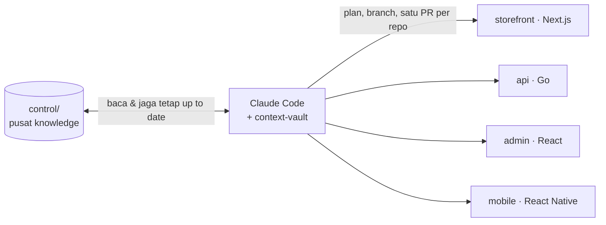

# context-vault

[English](README.md) · **Bahasa Indonesia**

 

[Cara kerjanya](#cara-kerjanya) · [Susunan knowledge](#knowledge-yang-tersusun) · [Alur kerja](#alur-kerja) · [Skill](#isinya-apa-aja) · [Mulai cepat](#mulai-cepat)

### Produk lo bukan satu repo. AI lo juga nggak boleh nganggep begitu.

Ada storefront, API, admin panel, mungkin juga app mobile. Claude Code cuma ngeliat repo yang lagi lo buka, jadi tiap fitur mulainya sama: jelasin ulang aturan bisnis, kontrak API, konvensi. Lagi dan lagi.

**context-vault** ngasih Claude Code satu lapisan knowledge yang tersusun dan selalu up to date buat *seluruh* produk lo. Contohnya satu fitur, dari awal sampai akhir:

```text
> /feature checkout-v2
  intake  → business.md ditulis (aturan, flow, edge case)        ✔ di-review critic
            aturan yang awet dipromosikan ke control/business/
  fanout  → kena storefront, api, admin
  plan    → plans/storefront.md · plans/api.md · plans/admin.md

> /breakdown checkout-v2         → tasks.yaml (14 task kecil, masing-masing ada test case)
> /build checkout-v2 --unattended   # jalan semalaman, gate berisiko nunggu review lo

> /ship checkout-v2
  ✔ code review   ✔ security gate   ✔ sesuai business.md
  → PR: acme/web#212 · acme/api#87 · acme/admin#45
  → halaman review buat rekan · doc produk di-render ulang
```
<sub>Contoh output.</sub>

## Cara kerjanya



Monorepo atau multi-repo, dua-duanya jalan. Di setup multi-repo, `control/` jadi repo hub sendiri; repo app lo tetap di tempatnya dan nggak pernah dimigrasi.

## Knowledge yang tersusun

```text
control/
├─ workspace.yaml    # peta produk: app, repo, stack, shared package, database
├─ business/         # aturan domain, flow, glosarium, risiko
├─ invariants.md     # aturan platform yang nggak boleh dilanggar
├─ conventions.md    # konvensi lintas-app
├─ integrations.md   # kontrak vendor (pembayaran, email, kurir, …)
├─ design-system.md  # token, motion, komponen primitif
├─ roadmap.md        # backlog terurut
├─ debt.yaml         # catatan utang teknis
└─ features/
   └─ checkout-v2/
      ├─ business.md     # alasan + aturannya
      ├─ fanout.md       # app mana aja yang kena
      ├─ plans/api.md    # satu plan per app
      └─ tasks.yaml      # yang dieksekusi /build
```

Skill-skillnya ngupdate file-file ini sambil kerja, jadi knowledge-nya ikut tumbuh tiap lo bikin fitur, bukan basi di wiki.

## Pengaman bawaan

- **Gate di tiap tahap.** Aturan bisnis, plan, kode, dan PR masing-masing nunggu approval lo dulu sebelum lanjut.
- **Agent red-team, bukan yes-man.** `critic` nyerang proposal di gate penting; `security-critic` me-review diff yang nyentuh pembayaran atau data pribadi.
- **Security gate sesuai tingkat risiko.** `/ship` nge-scan tiap fitur buat secret yang bocor dan PII di log, terus jalanin security review penuh kalau fiturnya ngurus uang atau data pribadi.
- **Knowledge yang nggak melenceng.** `/ask` jawab dari `control/` lengkap sama sumbernya, nandain catatan yang beda sama kode, terus nunjukin skill yang bisa benerin.
- **Build semalaman yang bisa dipercaya.** `/build --unattended` terus jalan, sementara langkah berisiko (migrasi destructive, perubahan sensitif keamanan) nunggu di antrian review buat pagi.

## Alur kerja

| Fase | Perintah&nbsp;&nbsp;&nbsp;&nbsp;&nbsp;&nbsp;&nbsp;&nbsp;&nbsp;&nbsp;&nbsp;&nbsp;&nbsp;&nbsp;&nbsp;&nbsp;&nbsp;&nbsp;&nbsp;&nbsp;&nbsp;&nbsp;&nbsp;&nbsp; | Hasilnya |
|---|---|---|
| **1 · Bentuk produknya** | `/discovery` → `/init` → `/roadmap` | ide yang udah divalidasi, scaffold `control/`, backlog terurut |
| **2 · Pasang fondasi** | `/architect` → `/wire` | stack + invarian platform, skeleton kosong yang udah jalan |
| **3 · Kirim fitur** *(diulang)* | `/feature` → `/breakdown` → `/build` → `/ship` | aturan bisnis, plan per app, kode yang lulus test, PR |

Udah punya kode? `/init` bisa ngadopsi monorepo atau multi-repo yang udah ada, dan `/extract` ngisi knowledge bisnis dari kodenya. Jalur samping, kapan aja: `/tweak` perubahan kecil · `/fix` bug · `/debt` utang teknis · `/drop` batalin fitur · `/ask` nanya.

## Isinya apa aja

26 skill, 2 agent red-team, dan seperangkat rules yang bikin mereka tetap jujur.

**Mulai produk**

| Skill&nbsp;&nbsp;&nbsp;&nbsp;&nbsp;&nbsp;&nbsp;&nbsp;&nbsp;&nbsp;&nbsp;&nbsp;&nbsp;&nbsp;&nbsp;&nbsp;&nbsp;&nbsp;&nbsp;&nbsp;&nbsp;&nbsp;&nbsp;&nbsp;&nbsp;&nbsp;&nbsp;&nbsp; | Fungsinya |
|---|---|
| `/discovery` | Validasi ide mentah: visi lo dulu, baru riset pasar, kompetitor, monetisasi, dan verdict go/no-go |
| `/init` | Mulai produk baru atau adopsi repo yang udah ada (monorepo atau multi-repo) |
| `/roadmap` | Ngubah konsep jadi backlog fitur terurut, lengkap sama epic dan dependensinya |
| `/architect` | Netapin (atau nyatet) stack per app, konvensi lintas-app, dan invarian platform |
| `/wire` | Nyalain skeleton yang jalan: scaffold app, database, wiring FE↔BE, env |
| `/extract` | Khusus kode yang udah ada: ngisi `control/business/` dari kode |

**Bikin fitur**

| Skill&nbsp;&nbsp;&nbsp;&nbsp;&nbsp;&nbsp;&nbsp;&nbsp;&nbsp;&nbsp;&nbsp;&nbsp;&nbsp;&nbsp;&nbsp;&nbsp;&nbsp;&nbsp;&nbsp;&nbsp;&nbsp;&nbsp;&nbsp;&nbsp;&nbsp;&nbsp;&nbsp;&nbsp; | Fungsinya |
|---|---|
| `/feature` | Ngejalanin pipeline fitur, ada gate di tiap tahap: `/intake` (bisnis) → `/fanout` (app mana) → `/plan` (plan teknis per app) |
| `/breakdown` | Mecah plan jadi task kecil berurutan lengkap sama test case |
| `/build` | Eksekusi task, satu subagent implementer per task (TDD) plus review; bisa dilanjut lintas sesi, bisa jalan tanpa diawasi |
| `/ship` | Gate review, kualitas, dan keamanan, cek keselarasan sama `business.md`, terus satu PR per repo |
| `/drop` | Batalin fitur dan nyimpen alasannya sebagai catatan keputusan |

**Numbuhin produk**: `/feature` manggil ini otomatis kalau fanout nemu hal baru.

| Skill&nbsp;&nbsp;&nbsp;&nbsp;&nbsp;&nbsp;&nbsp;&nbsp;&nbsp;&nbsp;&nbsp;&nbsp;&nbsp;&nbsp;&nbsp;&nbsp;&nbsp;&nbsp;&nbsp;&nbsp;&nbsp;&nbsp;&nbsp;&nbsp;&nbsp;&nbsp;&nbsp;&nbsp; | Fungsinya |
|---|---|
| `/add-app` | Nambah app baru (declare → architect → wire) |
| `/add-package` | Nambah shared package (ui-kit, types, utils) |
| `/add-integration` | Nambah vendor eksternal: kontrak di `integrations.md`, stub webhook kalau inbound |
| `/design-system` | Ngubah mockup jadi token + komponen primitif, atau dokumentasiin UI yang udah ada |

**Ubah & rawat**

| Skill&nbsp;&nbsp;&nbsp;&nbsp;&nbsp;&nbsp;&nbsp;&nbsp;&nbsp;&nbsp;&nbsp;&nbsp;&nbsp;&nbsp;&nbsp;&nbsp;&nbsp;&nbsp;&nbsp;&nbsp;&nbsp;&nbsp;&nbsp;&nbsp;&nbsp;&nbsp;&nbsp;&nbsp; | Fungsinya |
|---|---|
| `/tweak` | Perubahan kecil yang tetap tercatat (threshold, kebijakan) tanpa pipeline penuh; otomatis naik kelas kalau ternyata gede |
| `/fix` | Bug di perilaku yang udah ada: reproduce → root cause → fix pakai TDD, waktu build atau sesudah ship |
| `/debt` | Catatan utang teknis: `/build` nyatet utang yang ditemuin; lo yang list, triase, promote, atau drop |
| `/upgrade` | Nyusulin produk yang dibikin pakai versi plugin lama ke template terbaru, tanpa nyentuh knowledge |

**Pahami & bagikan**

| Skill&nbsp;&nbsp;&nbsp;&nbsp;&nbsp;&nbsp;&nbsp;&nbsp;&nbsp;&nbsp;&nbsp;&nbsp;&nbsp;&nbsp;&nbsp;&nbsp;&nbsp;&nbsp;&nbsp;&nbsp;&nbsp;&nbsp;&nbsp;&nbsp;&nbsp;&nbsp;&nbsp;&nbsp; | Fungsinya |
|---|---|
| `/ask` | Tanya apa aja soal produk lo; jawabannya nyebut sumber dari `control/` atau kode, read-only |
| `/guide` | Tur dan tanya-jawab soal plugin ini sendiri |
| `/render-docs` | Doc HTML seluruh produk yang gampang dibaca stakeholder |
| `/share` | Satu halaman review HTML per fitur buat rekan; paste balik feedback mereka buat ditriase |
| `/sync` | Kerja tim: nyusulin `control/` ke kode rekan yang udah merge di branch utama tiap repo; dicatat lengkap ke `control/`, lalu buka satu halaman ringkasan bisnis |
| `/review-pr` | Review PR rekan (plus PR satu tiket di repo lain) dalam empat lapis: konsistensi, best practice, alur lintas-repo, kontrak. Buka laporan HTML berisi vonis + draft komentar tinggal copy; nggak pernah posting ke GitHub |

## Mulai cepat

```text
/plugin marketplace add stevanus1997/context-vault
/plugin install context-vault
```

Terus:

```text
/guide                    # tur singkat: ada apa aja, mulai dari mana
/discovery                # ide masih mentah? validasi dulu (lanjut otomatis ke init)
/context-vault:init       # ide udah jelas atau repo udah ada? mulai dari sini
```

> `/context-vault:init` pakai nama lengkap karena Claude Code punya `/init` sendiri. Skill lainnya cukup pakai nama pendek.

## Perlu tau

<details>
<summary><b>Build semalaman (mode unattended)</b></summary>

`/build <fitur> --unattended` (atau `bash .claude/drive.sh <fitur>` biar terus jalan lintas sesi) nggak pernah berhenti gara-gara gate. Gate yang butuh mata manusia **diantriin** di `control/features/<fitur>/gates.yaml`, sementara task berikutnya tetap dibangun. Paginya, `/build <fitur>` (attended) nguras antrian itu: diff + test + `security-critic` + "kalau direvisi, apa aja yang kena", terus approve atau revisi per gate. Blocker beneran (migrasi destructive, langkah manual, error) cuma nahan subtree-nya sendiri; driver berhenti dengan `outcome: review` kalau udah nggak ada lagi yang bisa dibangun.

**Pantau progres:** di Claude Code, panel **🔨 build** kebuka sendiri waktu ada build jalan (`/cv-panel` buat buka/tutup manual): task ke berapa, lane yang jalan paralel, yang ketahan + alasannya, gate yang antri, dan estimasi sisa waktu (rentang, muncul sesudah 3 task kelar). Ada juga status line satu baris plus toast kalau ada yang nyangkut, dan `drive.sh` nampilin baris progres live di terminal. Read-only, butuh `python3`. Panelnya cuma ada di Claude Code (di Kimi cuma baris `drive.sh`).

`/breakdown` juga bisa nyatet kerja non-file (`actions:` buat migrasi, install, env) dan langkah manusia (`manual:` / `needs_human`). `/build` ngejalanin dan verifikasi semuanya (migrasi lewat gate; yang additive bisa auto-apply kalau lo opt-in) plus jalanin test integrasi lintas-app. `/build` dan `/ship` ngerti multi-repo: satu branch dan satu PR per repo.
</details>

<details>
<summary><b>Notif di HP (mode attended)</b></summary>

Nyetir sesi dari HP lewat Remote Control? Nyalain sekali di terminal: `/config` → **Push when actions required** (app Claude login di akun yang sama + izin notif OS). HP bunyi tiap ada skill yang nunggu lo: gate approve/revisi, pertanyaan keputusan, konfirmasi, permission prompt. Itu bisa karena titik tunggu attended ditanyain lewat kotak `AskUserQuestion` (`rules/ask-user.md`; `discovery`/`init` dikecualikan, tetap teks biasa). Push di-skip selama lo lagi fokus di terminal. Mode unattended tetap ngabarin lewat `notify.sh`.
</details>

<details>
<summary><b>Judul session otomatis</b></summary>

Session dikasih judul otomatis dari skill kerja yang lo panggil: `/build checkout-v2` → `build: checkout-v2` di `/resume`. Skill kerja terakhir yang menang; skill read-only (`/ask`, `/guide`, `/render-docs`, `/debt`) nggak ngubah judul. Butuh Claude Code v2.1.196+ (versi lama: no-op yang aman). Nama dari `/rename` manual bertahan sampai skill kerja berikutnya dipanggil, ini batasan hook Claude Code saat ini. Mekanisme `sessionTitle` lewat `UserPromptSubmit` udah diverifikasi empiris di v2.1.216; docs resmi baru nyebut itu buat `SessionStart`, jadi kalau CLI ke depannya berubah, hook-nya jadi no-op yang aman.
</details>

<details>
<summary><b>Kimi Code</b></summary>

Plugin ini juga jalan di [Kimi Code CLI](https://www.kimi.com/code/docs/en/) lewat tree hasil generate `plugin-kimi/`.

- **Install:** buka `kimi` → `/plugins` → tab **Custom** → install dari `<repo-ini>/plugin-kimi` → `/reload`.
- **Panggil:** `/skill:<nama>` (mis. `/skill:guide`, `/skill:build checkout-v2`).
- **Belum ada di Kimi:** judul session otomatis dan `build --unattended`. `kimi -p` auto-approve semua tool, jadi `build` versi Kimi nolak `--unattended`.
- **Hybrid:** state produk tinggal di disk (`control/`, `tasks.yaml`, git), jadi kerja interaktif bisa di tool mana aja; jalur unattended tetap lewat Claude Code: `bash .claude/drive.sh <fitur>`.

Maintainer: `plugin/` itu sumber kebenarannya. Cara regen `plugin-kimi/` ada di [docs/maintaining.md](docs/maintaining.md).
</details>

## Docs

- [Spec desain](docs/superpowers/specs/2026-05-24-ai-first-boilerplate-design.md): rancangan awal sistemnya
- [docs/maintaining.md](docs/maintaining.md): ritual rilis dan riwayat milestone
- Semua spec dan plan: [docs/superpowers/](docs/superpowers/)
