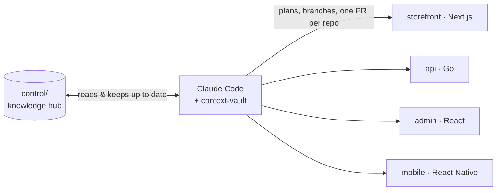

# context-vault

**English** · [Bahasa Indonesia](README.id.md)

 

[How it works](#how-it-works) · [Knowledge layout](#knowledge-organized) · [Workflow](#the-workflow) · [Skills](#whats-inside) · [Quick start](#quick-start)

### Your product isn't one repo. Your AI shouldn't think it is.

A storefront, an API, an admin panel, maybe a mobile app. Claude Code only sees the repo you opened, so every feature starts the same way: re-explaining the business rules, the API contract, the conventions. Again.

**context-vault** gives Claude Code one structured, always-current knowledge layer for your *whole* product. Here's one feature, end to end:

```text
> /feature checkout-v2
  intake  → business.md written (rules, flows, edge cases)       ✔ critic reviewed
            durable rules promoted to control/business/
  fanout  → touches storefront, api, admin
  plan    → plans/storefront.md · plans/api.md · plans/admin.md

> /breakdown checkout-v2         → tasks.yaml (14 small tasks, each with test cases)
> /build checkout-v2 --unattended   # runs overnight, risky gates wait for your review

> /ship checkout-v2
  ✔ code review   ✔ security gate   ✔ matches business.md
  → PRs: acme/web#212 · acme/api#87 · acme/admin#45
  → review page for teammates · product docs re-rendered
```
<sub>Illustrative output.</sub>

## How it works



Monorepo or multi-repo, both work. In a multi-repo setup `control/` is its own hub repo; your app repos stay exactly where they are and are never migrated.

## Knowledge, organized

```text
control/
├─ workspace.yaml    # the product map: apps, repos, stacks, shared packages, databases
├─ business/         # domain rules, flows, glossary, risks
├─ invariants.md     # platform rules that are never broken
├─ conventions.md    # cross-app conventions
├─ integrations.md   # vendor contracts (payments, email, couriers, …)
├─ design-system.md  # tokens, motion, primitive components
├─ roadmap.md        # ordered backlog
├─ debt.yaml         # tech-debt registry
└─ features/
   └─ checkout-v2/
      ├─ business.md     # the why + the rules
      ├─ fanout.md       # which apps are touched
      ├─ plans/api.md    # one plan per app
      └─ tasks.yaml      # what /build executes
```

Skills update these files as part of their normal work, so knowledge grows as you build features instead of rotting in a wiki.

## Built-in guardrails

- **A gate at every stage.** Business rules, plans, code and PRs each wait for your approval before moving on.
- **Red-team agents, not yes-men.** `critic` attacks proposals at key gates; `security-critic` reviews diffs that touch payments or personal data.
- **Security gate scaled to risk.** `/ship` scans every feature for leaked secrets and PII in logs, and runs a full security review when the feature handles money or personal data.
- **Knowledge that doesn't drift.** `/ask` answers from `control/` with sources, flags notes that disagree with the code, and points you to the skill that fixes them.
- **Overnight builds you can trust.** `/build --unattended` keeps going while risky steps (destructive migrations, security-sensitive changes) wait in a review queue for the morning.

## The workflow

| Phase | Commands&nbsp;&nbsp;&nbsp;&nbsp;&nbsp;&nbsp;&nbsp;&nbsp;&nbsp;&nbsp;&nbsp;&nbsp;&nbsp;&nbsp;&nbsp;&nbsp;&nbsp;&nbsp;&nbsp;&nbsp;&nbsp;&nbsp;&nbsp;&nbsp; | What you get |
|---|---|---|
| **1 · Shape the product** | `/discovery` → `/init` → `/roadmap` | a validated idea, the `control/` scaffold, an ordered backlog |
| **2 · Lay the foundation** | `/architect` → `/wire` | stack + platform invariants, an empty skeleton that runs |
| **3 · Ship features** *(repeat)* | `/feature` → `/breakdown` → `/build` → `/ship` | business rules, per-app plans, tested code, PRs |

Already have code? `/init` adopts an existing monorepo or multi-repo, and `/extract` back-fills business knowledge from it. Side lanes, any time: `/tweak` small changes · `/fix` bugs · `/debt` tech debt · `/drop` cancel a feature · `/ask` questions.

## What's inside

26 skills, 2 red-team agents, and a set of rules that keep them honest.

**Start a product**

| Skill&nbsp;&nbsp;&nbsp;&nbsp;&nbsp;&nbsp;&nbsp;&nbsp;&nbsp;&nbsp;&nbsp;&nbsp;&nbsp;&nbsp;&nbsp;&nbsp;&nbsp;&nbsp;&nbsp;&nbsp;&nbsp;&nbsp;&nbsp;&nbsp;&nbsp;&nbsp;&nbsp;&nbsp; | What it does |
|---|---|
| `/discovery` | Validates a raw idea: your vision first, then market, competitors, monetization and a go/no-go verdict |
| `/init` | Starts a new product or adopts existing repos (monorepo or multi-repo) |
| `/roadmap` | Turns the concept into an ordered backlog of features, epics and dependencies |
| `/architect` | Sets (or records) the stack per app, cross-app conventions and platform invariants |
| `/wire` | Brings up a running skeleton: scaffolded apps, database, FE↔BE wiring, env |
| `/extract` | Existing code only: back-fills `control/business/` from the code |

**Build features**

| Skill&nbsp;&nbsp;&nbsp;&nbsp;&nbsp;&nbsp;&nbsp;&nbsp;&nbsp;&nbsp;&nbsp;&nbsp;&nbsp;&nbsp;&nbsp;&nbsp;&nbsp;&nbsp;&nbsp;&nbsp;&nbsp;&nbsp;&nbsp;&nbsp;&nbsp;&nbsp;&nbsp;&nbsp; | What it does |
|---|---|
| `/feature` | Runs the feature pipeline, with a gate at each stage: `/intake` (business) → `/fanout` (which apps) → `/plan` (per-app technical plan) |
| `/breakdown` | Splits the plan into small ordered tasks with test cases |
| `/build` | Executes tasks with one implementer subagent per task (TDD) plus review; resumable, can run unattended |
| `/ship` | Review, quality and security gates, an alignment check against `business.md`, then one PR per repo |
| `/drop` | Cancels a feature and keeps the reason as a decision record |

**Grow the product**: `/feature` calls these automatically when fanout finds something new.

| Skill&nbsp;&nbsp;&nbsp;&nbsp;&nbsp;&nbsp;&nbsp;&nbsp;&nbsp;&nbsp;&nbsp;&nbsp;&nbsp;&nbsp;&nbsp;&nbsp;&nbsp;&nbsp;&nbsp;&nbsp;&nbsp;&nbsp;&nbsp;&nbsp;&nbsp;&nbsp;&nbsp;&nbsp; | What it does |
|---|---|
| `/add-app` | Adds a new app (declare → architect → wire) |
| `/add-package` | Adds a shared package (ui-kit, types, utils) |
| `/add-integration` | Adds an external vendor: contract in `integrations.md`, webhook stub when inbound |
| `/design-system` | Turns mockups into tokens + primitive components, or documents an existing UI |

**Change & maintain**

| Skill&nbsp;&nbsp;&nbsp;&nbsp;&nbsp;&nbsp;&nbsp;&nbsp;&nbsp;&nbsp;&nbsp;&nbsp;&nbsp;&nbsp;&nbsp;&nbsp;&nbsp;&nbsp;&nbsp;&nbsp;&nbsp;&nbsp;&nbsp;&nbsp;&nbsp;&nbsp;&nbsp;&nbsp; | What it does |
|---|---|
| `/tweak` | Small, traceable changes (a threshold, a policy) without the full pipeline; escalates itself if it turns out big |
| `/fix` | Bugs in existing behavior: reproduce → root cause → TDD fix, during a build or after shipping |
| `/debt` | Tech-debt registry: `/build` records debt it finds; you list, triage, promote or drop it |
| `/upgrade` | Brings a product created with an older plugin version up to the latest template, without touching knowledge |

**Understand & share**

| Skill&nbsp;&nbsp;&nbsp;&nbsp;&nbsp;&nbsp;&nbsp;&nbsp;&nbsp;&nbsp;&nbsp;&nbsp;&nbsp;&nbsp;&nbsp;&nbsp;&nbsp;&nbsp;&nbsp;&nbsp;&nbsp;&nbsp;&nbsp;&nbsp;&nbsp;&nbsp;&nbsp;&nbsp; | What it does |
|---|---|
| `/ask` | Ask anything about your product; answers cite `control/` or the code, read-only |
| `/guide` | Tour and Q&A about this plugin itself |
| `/render-docs` | Human-readable HTML docs of the whole product for stakeholders |
| `/share` | One HTML review page per feature for teammates; paste their feedback back to triage it |

## Quick start

```text
/plugin marketplace add stevanus1997/context-vault
/plugin install context-vault
```

Then:

```text
/guide                    # quick tour: what's here, where to start
/discovery                # raw idea? validate it first (continues into init)
/context-vault:init       # clear idea or existing repos? start here
```

> `/context-vault:init` uses the full name because Claude Code has its own `/init`. Every other skill works by its short name.

## Good to know

<details>
<summary><b>Overnight builds (unattended mode)</b></summary>

`/build <feature> --unattended` (or `bash .claude/drive.sh <feature>` to keep it going across sessions) never stops for a gate. Gates that need human eyes are **queued** in `control/features/<feature>/gates.yaml` while the next tasks keep building. In the morning, `/build <feature>` (attended) drains the queue: diff + tests + `security-critic` + "what changes if you revise this", then approve or revise per gate. Real blockers (destructive migrations, manual steps, errors) only hold their own subtree; the driver stops with `outcome: review` when nothing else can be built.

**Watch progress:** in Claude Code, the **🔨 build** panel opens by itself while a build runs (`/cv-panel` toggles it): current task, parallel lanes, what's held and why, queued gates, and a remaining-time range (shown after 3 tasks finish). There's a one-line status line plus a toast when something gets stuck, and `drive.sh` prints a live progress line in the terminal. Read-only, needs `python3`. The panel is Claude Code only (Kimi gets the `drive.sh` line).

`/breakdown` can also describe non-file work (`actions:` for migrations, installs, env) and human steps (`manual:` / `needs_human`). `/build` runs and verifies them (migrations go through a gate; additive ones can auto-apply when you opt in) and runs cross-app integration tests. `/build` and `/ship` are multi-repo aware: one branch and one PR per repo.
</details>

<details>
<summary><b>Phone notifications (attended mode)</b></summary>

Driving a session from your phone via Remote Control? Turn it on once in the terminal: `/config` → **Push when actions required** (Claude app signed in to the same account + OS notification permission). Your phone buzzes whenever a skill waits for you: gate approvals, decision questions, confirmations, permission prompts. That works because attended waiting points are asked through the `AskUserQuestion` box (`rules/ask-user.md`; `discovery`/`init` are exempt and stay plain text). Pushes are skipped while you're focused on the terminal. Unattended mode notifies through `notify.sh` instead.
</details>

<details>
<summary><b>Auto-titled sessions</b></summary>

Sessions are titled after the working skill you call: `/build checkout-v2` → `build: checkout-v2` in `/resume`. The last working skill wins; read-only skills (`/ask`, `/guide`, `/render-docs`, `/debt`) leave the title alone. Needs Claude Code v2.1.196+ (older versions: a safe no-op). A manual `/rename` holds until the next working skill is called, a current Claude Code hook limitation. The `sessionTitle` mechanism via `UserPromptSubmit` was verified empirically on v2.1.216; official docs only list it for `SessionStart`, so if a future CLI changes this, the hook becomes a safe no-op.
</details>

<details>
<summary><b>Kimi Code</b></summary>

The plugin also runs on [Kimi Code CLI](https://www.kimi.com/code/docs/en/) via the generated `plugin-kimi/` tree.

- **Install:** open `kimi` → `/plugins` → **Custom** tab → install from `<this-repo>/plugin-kimi` → `/reload`.
- **Invoke:** `/skill:<name>` (e.g. `/skill:guide`, `/skill:build checkout-v2`).
- **Not yet on Kimi:** auto-titled sessions and `build --unattended`. `kimi -p` auto-approves every tool, so the Kimi version of `build` refuses `--unattended`.
- **Hybrid:** product state lives on disk (`control/`, `tasks.yaml`, git), so interactive work can happen in either tool; the unattended lane stays on Claude Code via `bash .claude/drive.sh <feature>`.

Maintainers: `plugin/` is the source of truth. See [docs/maintaining.md](docs/maintaining.md) for regenerating `plugin-kimi/`.
</details>

## Docs

- [Design spec](docs/superpowers/specs/2026-05-24-ai-first-boilerplate-design.md): the original design of the system
- [docs/maintaining.md](docs/maintaining.md): release ritual and milestone history
- All specs and plans: [docs/superpowers/](docs/superpowers/)
